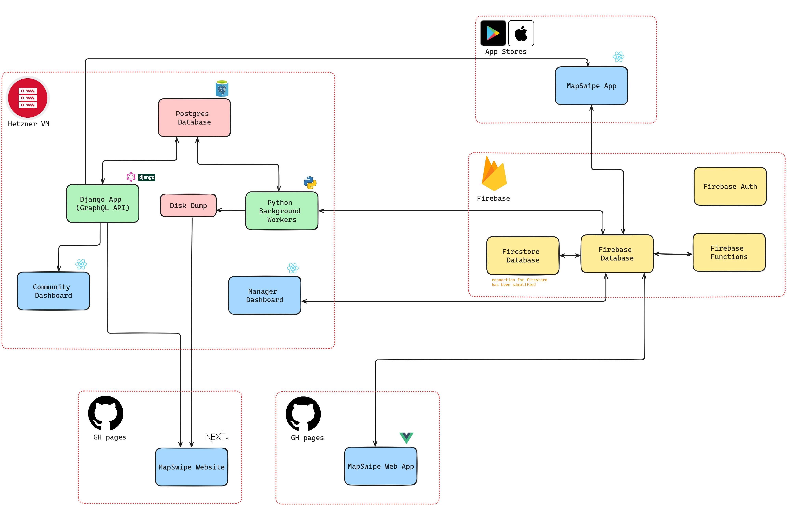
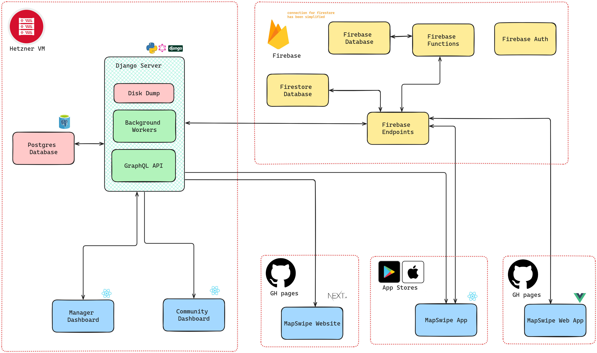

# System Architecture

This page describes how the MapSwipe system is put together: the old vs. new architecture, and the individual components that make up the new architecture today.

## Architecture overview

### Old architecture

<figure>
    
    <figcaption>Previous MapSwipe architectural flow</figcaption>
</figure>

The legacy system had two different databases:

1. **Firebase** — the primary database. It interfaced directly with the Manager Dashboard, Mobile App, and Web App, and stored users, user groups, draft projects, active projects (with tasks), user contributions, and user swipe results (temporarily).
2. **Postgres** — the secondary, long-term database. It stored users, user groups, draft projects, all projects (with tasks), and all user swipe results.

The primary reason for keeping Firebase as the primary database was auto-scaling in case of a large number of submissions, typically during MapSwipe mapping events. A background worker periodically synchronized (partially) the two databases.

### New architecture

<figure>
    
    <figcaption>New MapSwipe architectural flow</figcaption>
</figure>

The major difference in the new architecture is that **Postgres is the primary database**. Only the MapSwipe mobile and web apps interface with Firebase directly. The system stays scalable and reliable while significantly reducing the usage of the Firebase Realtime Database. See the [Components](#components) section below for an inventory of the pieces.

> [!NOTE]
> **Firebase Endpoints** shown in the new architecture diagram is planned for a future iteration and has not yet been implemented. Today, the mobile and web apps still read from and write to the Firebase Realtime Database directly.

## Components

### Public Website

- **Source:** [`mapswipe/website`](https://github.com/mapswipe/website)
- **Deployed at:** <https://mapswipe.org/>

The public information site for MapSwipe. It introduces the project and its partners, lists the project types, links to the mobile and web apps, and publishes blog posts. It also hosts:

- The [Data](https://mapswipe.org/en/data/) page, with the project list and the global exports documented under [About the Data](/docs/about_data/).
- The [Get Involved](https://mapswipe.org/en/get-involved/) page, with ways to contribute (translation, development, donations) and the [MapSwipe Event Toolkit](https://drive.google.com/drive/folders/1j5XnyqI_LKYBCg9oJaaWIKbsBxwB8Cld) for groups hosting mapping events. The toolkit includes the event logos.

### Manager Dashboard

- **Source:** [`mapswipe/manager-dashboard`](https://github.com/mapswipe/manager-dashboard)
- **Deployed at:** <https://managers.mapswipe.org/>

The web application project managers use to create and manage projects, tutorials, organisations, managers, contributors, user groups, and teams. Talks to the MapSwipe backend via GraphQL. See [For Project Managers](/docs/for_project_managers/) for the user-facing documentation.

### Backend

- **Source:** [`mapswipe/mapswipe-backend`](https://github.com/mapswipe/mapswipe-backend)

The central **Django server** backed by Postgres. A single service is responsible for:

- The **GraphQL API** consumed by the [Manager Dashboard](#manager-dashboard) and the [Community Dashboard](#community-dashboard).
- **Data synchronisation** between Postgres and Firebase Realtime Database — including the background workers that transfer in-flight results out of Firebase and into Postgres for long-term storage.
- The **data-export generation** that produces the files documented under [About the Data](/docs/about_data/).

### Firebase Cloud Functions

- **Source:** [`mapswipe/mapswipe-firebase`](https://github.com/mapswipe/mapswipe-firebase)

Cloud Functions that react to Firebase Realtime Database events — incrementing per-user contribution counters when results arrive, propagating user-group membership changes, queuing PSQL-sync flags so the backend knows what changed, and serving the OSM OAuth login.

The functions co-exist with the runtime **Firebase Realtime Database**, which holds active project / group / task data and in-flight result submissions until the backend workers transfer them to Postgres database.

### Mobile App

- **Source:** [`mapswipe/mapswipe-mobile`](https://github.com/mapswipe/mapswipe-mobile)
- **Deployed at:**
    - Android — [Google Play Store](https://play.google.com/store/apps/details?id=org.missingmaps.mapswipe)
    - iOS — [App Store](https://apps.apple.com/us/app/mapswipe/id1133855392)

The contributor-facing app where users swipe to complete tasks. Reads project, group, and task data from Firebase Realtime Database; writes submitted results back to Firebase, which are then synced to the backend.

### Web App

- **Source:** [`mapswipe/mapswipe-web`](https://github.com/mapswipe/mapswipe-web)
- **Deployed at:** <https://web.mapswipe.org/>

The browser version of the contributor app. Like the Mobile App, it reads project, group, and task data from Firebase Realtime Database and writes submitted results back to Firebase, which are then synced to the backend.

### Community Dashboard

- **Source:** [`mapswipe/community-dashboard`](https://github.com/mapswipe/community-dashboard)
- **Deployed at:** <https://community.mapswipe.org/>

A React-based static site showcasing aggregated MapSwipe contribution stats, plus profile pages for users, user groups, and organisations. Reads cached aggregated data from the backend.
